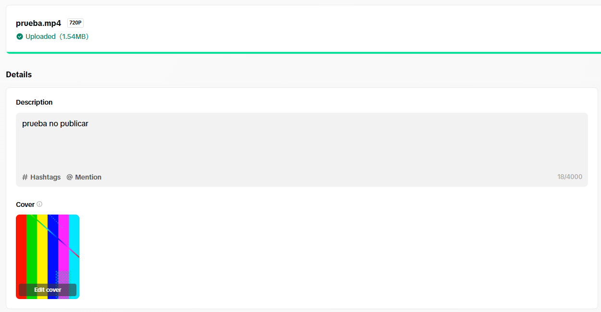
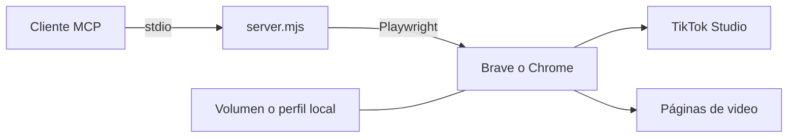

# mcp-tiktok

Servidor [MCP](https://modelcontextprotocol.io) para gestionar una cuenta de TikTok desde un asistente de IA: subir videos, consultar métricas y publicar comentarios.

Funciona automatizando la web de TikTok con Brave o Google Chrome. Se ejecuta en Docker o directamente con Node.js.

> Proyecto independiente, sin relación con TikTok. Automatizar la web puede ir en contra de sus normas: úsalo con tu propia cuenta y bajo tu responsabilidad.

## Funciones

- Listar videos con vistas, likes, comentarios, compartidos y guardados.
- Consultar seguidores, seguidos y likes de una cuenta.
- Subir videos con descripción y privacidad.
- Publicar comentarios.

Las subidas son seguras por defecto: sin `publish=true` no se publica nada, la privacidad inicial es `private` y, si no se puede confirmar la privacidad elegida, la operación se detiene.



## Inicio rápido con Docker

Construye la imagen:

```bash
git clone https://github.com/HubertValderramaCampos/mcp_tiktok.git
cd mcp_tiktok
docker build -t mcp-tiktok .
```

Agrega el servidor a tu cliente MCP:

```json
{
  "mcpServers": {
    "tiktok": {
      "command": "docker",
      "args": [
        "run", "-i", "--rm",
        "-v", "mcp-tiktok-data:/data",
        "-v", "/ruta/a/tus/videos:/videos:ro",
        "-p", "127.0.0.1:6080:6080",
        "mcp-tiktok"
      ]
    }
  }
}
```

Luego inicia sesión una sola vez:

1. Pide a tu asistente que ejecute `tiktok_login`.
2. Abre <http://localhost:6080/vnc.html> y pulsa **Connect**.
3. Inicia sesión en TikTok con el código QR.

La sesión queda guardada en el volumen `mcp-tiktok-data`. Los detalles están en la [guía de Docker](docs/docker.md).

## Instalación con Node.js

Necesitas Node.js 20 o superior y [Brave](https://brave.com) o [Google Chrome](https://www.google.com/chrome/). El servidor usa Brave si está instalado y, si no, Chrome. Para elegir uno, define `TIKTOK_BROWSER`.

```bash
git clone https://github.com/HubertValderramaCampos/mcp_tiktok.git
cd mcp_tiktok
npm install
```

Claude Code detecta el servidor con el archivo `.mcp.json` al abrir la carpeta. En otros clientes usa:

```json
{
  "mcpServers": {
    "tiktok": {
      "command": "node",
      "args": ["/ruta/completa/a/mcp_tiktok/server.mjs"]
    }
  }
}
```

Después ejecuta `tiktok_login` e inicia sesión en la ventana del navegador. La sesión se guarda en un perfil dedicado, separado de tu navegador habitual.

## Herramientas

| Herramienta | Descripción |
|---|---|
| `tiktok_login` | Abre el navegador para iniciar sesión manualmente |
| `tiktok_list_videos` | Lista los videos de la cuenta con sus métricas |
| `tiktok_get_video` | Muestra las métricas de un video |
| `tiktok_account_stats` | Muestra las estadísticas de una cuenta |
| `tiktok_upload_video` | Prepara o publica un video |
| `tiktok_post_comment` | Publica un comentario |

Parámetros y respuestas en la [referencia de herramientas](docs/herramientas.md).

## Cómo funciona



La API oficial de TikTok no ofrece un endpoint para escribir comentarios y, sin una auditoría de la aplicación, solo permite publicar contenido privado. Por eso el servidor usa la web, igual que una persona desde el navegador.

Las métricas se leen de la respuesta que TikTok Studio recibe al cargar la página, sin reproducir firmas ni tokens.

El servidor depende de la interfaz web de TikTok, por lo que un cambio en ella puede requerir ajustes.

## Configuración

| Variable | Descripción | Valor por defecto |
|---|---|---|
| `TIKTOK_BROWSER` | Navegador: `brave` o `chrome` | Brave si está instalado; si no, Chrome |
| `BROWSER_PATH` | Ruta del ejecutable del navegador | Ruta estándar del sistema |
| `TIKTOK_MCP_DIR` | Carpeta del perfil y las capturas | `%LOCALAPPDATA%\mcp-tiktok`; en Docker, `/data` |
| `TIKTOK_USERNAME` | Cuenta por defecto de `tiktok_account_stats` | Sin definir |

## Seguridad

- No compartas cookies, tokens ni las carpetas `brave-profile` y `chrome-profile`: dan acceso a tu cuenta.
- Revisa las capturas antes de compartirlas, porque pueden mostrar datos de la cuenta.
- Publica el puerto 6080 solo en `127.0.0.1`. La vista remota no tiene contraseña y muestra tu sesión.
- En un servidor, accede a ese puerto con un túnel SSH.

## Solución de problemas

| Problema | Solución |
|---|---|
| `No hay sesion iniciada` | Ejecuta `tiktok_login` |
| `TikTok muestra un captcha` | Resuélvelo manualmente en la ventana del navegador y reintenta |
| `Maximum number of attempts reached` | Es un límite de TikTok: espera unas horas y usa el código QR |
| Resultado `unconfirmed` | Revisa la captura antes de reintentar para evitar duplicados |
| Un tutorial bloquea la página | Se cierran automáticamente los tutoriales conocidos; si aparece otro, abre un issue |
